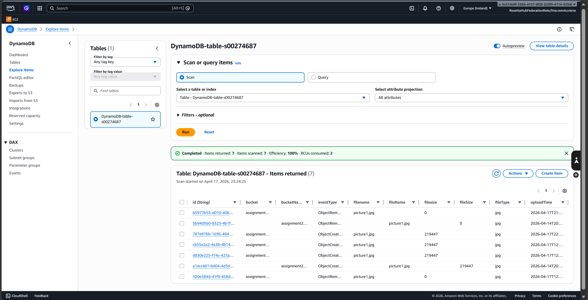
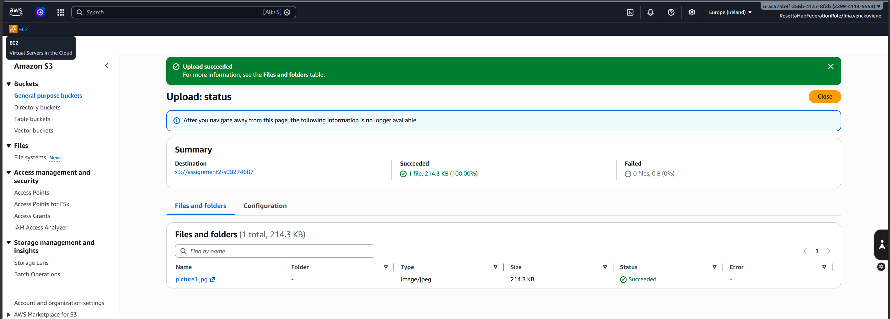
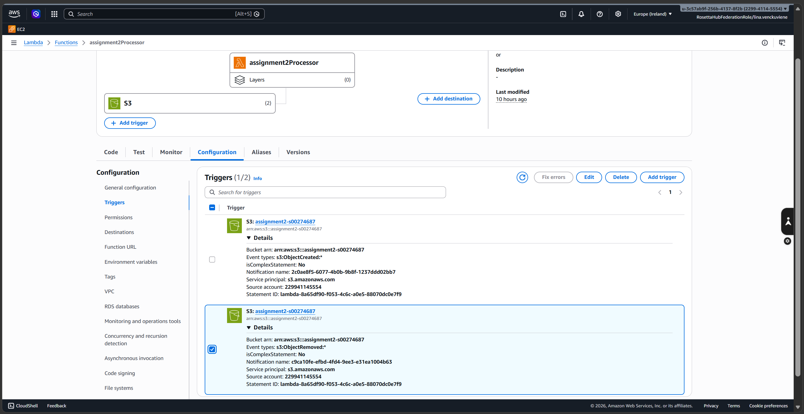
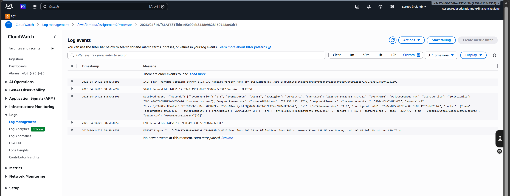
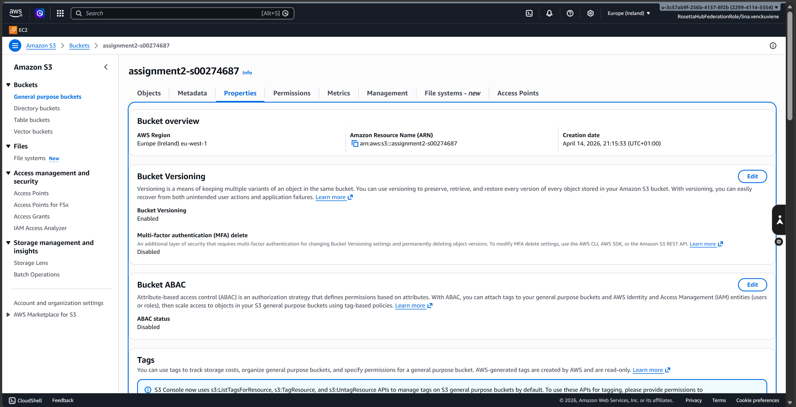
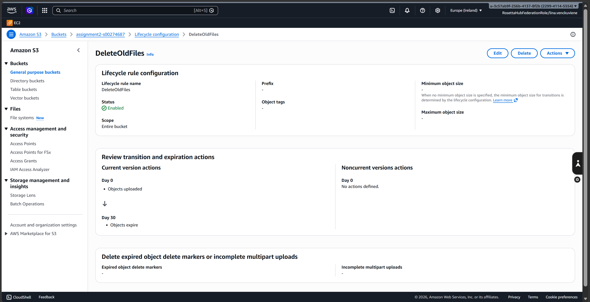

# AWS Serverless File Processor

Cloud Computing Assignment completed at Atlantic Technological University (ATU).

## Project Overview

This project implements a serverless application using Amazon S3, AWS Lambda, DynamoDB, and CloudWatch.

The system automatically reacts to file uploads and deletions in an S3 bucket. AWS Lambda processes the event information and stores file details in a DynamoDB table.

## AWS Services Used

- Amazon S3
- AWS Lambda
- Amazon DynamoDB
- Amazon CloudWatch
- AWS IAM

## Architecture

S3 Bucket
↓
Lambda Trigger
↓
AWS Lambda Function
↓
DynamoDB Table
↓
CloudWatch Logs

## Features Implemented

### DynamoDB

- Table: DynamoDB-table-s00274687
- Partition Key: id
- Stores uploaded file information

### Amazon S3

- Bucket: assignment2-s00274687
- Stores uploaded files
- Triggers Lambda automatically

### AWS Lambda

- Function: assignment2Processor
- Python runtime
- Processes S3 events
- Writes records to DynamoDB

### IAM Permissions

- AmazonDynamoDBFullAccess
- Lambda execution role

### CloudWatch Monitoring

- Automatic logging
- Execution monitoring
- Error tracking

## Extensions Added

### Delete Event Processing

A second trigger was configured to detect file deletions.

Lambda records:

- ObjectCreated:Put
- ObjectRemoved:Delete

events in DynamoDB.

### S3 Versioning

Versioning was enabled to improve recovery and data protection.

### Lifecycle Rules

Lifecycle rule: DeleteOldFiles

- Applies to all objects
- Automatically deletes files after 30 days
- Reduces storage costs

## Python Technologies Used

- boto3
- datetime
- uuid

## Learning Outcomes

This project demonstrates practical experience with:

- Serverless Computing
- Event Driven Architecture
- AWS Lambda
- DynamoDB
- CloudWatch Monitoring
- IAM Security
- Python Development
- Cloud Automation

## Author

Lina Venckus(Venckuviene)

Computer Science Graduate

Atlantic Technological University (ATU)

## Project Screenshots

The following screenshots demonstrate the AWS configuration, testing, and successful execution of this serverless application.

### 1. DynamoDB Records

### 2. Successful S3 File Upload

### 3. AWS Lambda S3 Triggers

### 4. CloudWatch Execution Logs

### 5. S3 Bucket Versioning

### 6. S3 Lifecycle Rule

